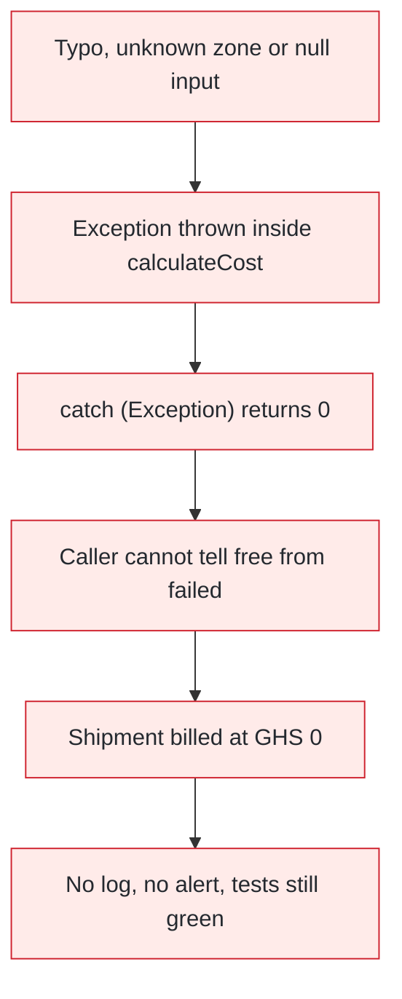

# Tidewater Freight: Code and Test Analysis

Written before any refactoring, as the analysis check-in. Rules are cited from the
AmaliTech Coding Standards, Java Edition (for example §6.1).

## 1. Summary

The service compiles, the three tests pass, and the demo prints sensible prices for
valid input. It cannot be trusted with anything else: an unknown zone, a typo or a
null input is quietly priced at **GHS 0**, and a negative weight gives a negative
price. The tests did not catch any of this because none of them can fail on a wrong
price.

Almost every problem comes from three root causes:

1. **Failures are hidden, not handled.** One catch-all turns every error into a valid-looking `0`.
2. **One method owns every rule.** Rate lookup, fees, surcharge, service level, printing and error policy all live in `calculateCost`, behind a hard-wired dependency.
3. **The tests check that something came back, not that it is right.**

## 2. Evidence

**Demo output** (`mvn compile exec:java -Dexec.mainClass=com.tidewater.freight.Demo`):

```diff
  Shipping DOMESTIC (10.0kg, STANDARD): GHS 50.0
  Result DOMESTIC 10kg STANDARD       -> 50.0
  Shipping INTERNATIONAL (40.0kg, EXPRESS): GHS 967.5
  Result INTERNATIONAL 40kg EXPRESS   -> 967.5
- Result unknown zone MOON 10kg STD   -> 0.0
```

**Edge cases** (run against the starter code in `jshell`):

| Input | Result | Should be |
|---|---|---|
| `DOMESTIC`, -10 kg, `STANDARD` | `-50.0` | rejected |
| `REGIONAL`, 0 kg, `STANDARD` | `10.0` | rejected |
| `DOMESTIC`, `NaN` kg, `STANDARD` | `NaN` | rejected |
| `null` zone, 10 kg, `STANDARD` | `0.0` | rejected |
| `DOMESTIC`, 10 kg, `null` level | `0.0` | rejected |
| `DOMESTIC`, 10 kg, `"express"` | `50.0` (standard price) | `75.0` or rejected |
| `REGIONAL`, 2.3 kg, `EXPRESS` | `42.599999999999994` | `42.60` |

**Mutation testing** (`mvn test-compile org.pitest:pitest-maven:mutationCoverage`):
PIT plants small bugs in the code and checks whether a test fails.

| Scope | Mutants | Caught | Line coverage |
|---|---|---|---|
| Whole project | 18 | 3 (17%) | 20 of 33 (61%) |
| `ShippingCalculator` | 13 | 1 | 8 survived, 4 never run |

The one mutant caught in `ShippingCalculator` is "return 0". Flipping `*` to `/`,
`+` to `-`, `>` to `>=`, or deleting the console print all pass the suite. The
INTERNATIONAL fee, the heavy surcharge and the express multiplier are never run.

## 3. Problems in the code, ranked by risk

| Rank | Problem | Kind | Severity |
|---|---|---|---|
| 1 | Catch-all returns `0` | Anti-pattern: error hiding | $\color{red}\textsf{Critical}$ |
| 2 | `calculateCost` does six jobs | SRP violation | $\color{darkorange}\textsf{High}$ |
| 3 | Zone rules in an `if/else` chain, split across two classes | OCP violation, DRY | $\color{darkorange}\textsf{High}$ |
| 4 | Rate source hard-wired with `new` | DIP violation | $\color{darkorange}\textsf{High}$ |
| 5 | No input validation | Bug | $\color{darkorange}\textsf{High}$ |
| 6 | Zone and service level are free strings | Primitive obsession | $\color{darkorange}\textsf{High}$ |
| 7 | Money held as `double` | Bug risk | $\color{darkgoldenrod}\textsf{Medium}$ |
| 8 | `System.out.println` in business logic | Hidden side effect | $\color{darkgoldenrod}\textsf{Medium}$ |
| 9 | Rule order and the 30 kg boundary are unstated | Hidden business rule | $\color{darkgoldenrod}\textsf{Medium}$ |
| 10 | Magic numbers | Smell | $\color{darkgoldenrod}\textsf{Medium}$ |
| 11 | Generic `IllegalArgumentException` for an unknown zone | Smell | $\color{darkgoldenrod}\textsf{Medium}$ |
| 12 | Three parameters | Smell | $\color{gray}\textsf{Low}$ |
| 13 | Comments that say *what*, an empty branch | Smell | $\color{gray}\textsf{Low}$ |
| 14 | Vague field name `repository` | Smell | $\color{gray}\textsf{Low}$ |
| 15 | `Demo` lines over 100 columns, horizontal alignment | Smell | $\color{gray}\textsf{Low}$ |

### 3.1 Catch-all returns 0 $\color{red}\textsf{Critical}$

[ShippingCalculator.java:34](https://github.com/athanasius-amalitech/code-quality-b-tidewater-freight/blob/e1b47905a36c4bae142bf6652b7fc1a15511728b/src/main/java/com/tidewater/freight/ShippingCalculator.java#L34)
catches `Exception` and returns `0`.

- **Root cause:** the catch is too broad and has no recovery. It catches the `IllegalArgumentException` for an unknown or null zone, but also the `NullPointerException` from a null service level, and any future bug in the method.
- **Risk:** the caller cannot tell "free" from "failed", so a shipment is priced at GHS 0 and nobody is told. Breaks §6.1 and §6.3.

### 3.2 `calculateCost` does six jobs $\color{darkorange}\textsf{High}$

[ShippingCalculator.java:8 to 38](https://github.com/athanasius-amalitech/code-quality-b-tidewater-freight/blob/e1b47905a36c4bae142bf6652b7fc1a15511728b/src/main/java/com/tidewater/freight/ShippingCalculator.java#L8):
looks up the rate, adds zone fees, adds the heavy surcharge, applies the service
level, prints to the console, and decides the error policy.

- **Root cause:** every rule was added to the one method that already existed.
- **Risk:** six reasons to change one method (§12.1, §4.2), and none of the rules can be tested on its own.

### 3.3 Zone rules hard-coded and split $\color{darkorange}\textsf{High}$

The per-kg rate lives in
[InMemoryRateRepository.java:11 to 13](https://github.com/athanasius-amalitech/code-quality-b-tidewater-freight/blob/e1b47905a36c4bae142bf6652b7fc1a15511728b/src/main/java/com/tidewater/freight/InMemoryRateRepository.java#L11),
the handling fee in the `if/else` chain at
[ShippingCalculator.java:14 to 20](https://github.com/athanasius-amalitech/code-quality-b-tidewater-freight/blob/e1b47905a36c4bae142bf6652b7fc1a15511728b/src/main/java/com/tidewater/freight/ShippingCalculator.java#L14).

- **Root cause:** a zone's rules have no single home (§2.2 DRY).
- **Risk:** the new zone the business is about to add means editing both classes and the existing chain (§12.2). Add the rate but forget the fee, and the new zone silently has no fee.

### 3.4 Rate source hard-wired $\color{darkorange}\textsf{High}$

[ShippingCalculator.java:6](https://github.com/athanasius-amalitech/code-quality-b-tidewater-freight/blob/e1b47905a36c4bae142bf6652b7fc1a15511728b/src/main/java/com/tidewater/freight/ShippingCalculator.java#L6):
`private final RateRepository repository = new InMemoryRateRepository();`

- **Root cause:** the `RateRepository` interface exists, but the calculator builds its own implementation instead of receiving one (§12.5). The code's own comment on line 5 says so.
- **Risk:** no test can give the calculator a fake rate source, so every test depends on the real rates.

### 3.5 No input validation $\color{darkorange}\textsf{High}$

Negative, zero and `NaN` weights are priced (see section 2). Nulls fall into the catch-all.

- **Risk:** negative or meaningless prices reach the caller as if valid.

### 3.6 Free-string zone and service level $\color{darkorange}\textsf{High}$

[ShippingCalculator.java:28](https://github.com/athanasius-amalitech/code-quality-b-tidewater-freight/blob/e1b47905a36c4bae142bf6652b7fc1a15511728b/src/main/java/com/tidewater/freight/ShippingCalculator.java#L28)
only checks `serviceLevel.equals("EXPRESS")`.

- **Risk:** `"express"`, `"Express"` or `"OVERNIGHT"` are silently charged the standard price. A typo in a zone becomes GHS 0 through 3.1.

### 3.7 Money as `double` $\color{darkgoldenrod}\textsf{Medium}$

`REGIONAL`, 2.3 kg, `EXPRESS` returns `42.599999999999994`, and the console prints
`GHS 42.599999999999994`. Currency needs `BigDecimal` with a defined rounding rule.

### 3.8 Console output in business logic $\color{darkgoldenrod}\textsf{Medium}$

[ShippingCalculator.java:32](https://github.com/athanasius-amalitech/code-quality-b-tidewater-freight/blob/e1b47905a36c4bae142bf6652b7fc1a15511728b/src/main/java/com/tidewater/freight/ShippingCalculator.java#L32)
prints every calculation. It is a side effect hidden in a calculation (§4.4); PIT
shows that deleting it changes no test result.

### 3.9 Unstated business rules $\color{darkgoldenrod}\textsf{Medium}$

- **Order matters.** Express ×1.5 is applied last, so it also multiplies the handling fee and the heavy surcharge. `INTERNATIONAL`, 40 kg, `EXPRESS` is `(600 + 25 + 20) × 1.5 = 967.5`; multiplying only the base would give 945.
- **The boundary.** `weightKg > 30` means exactly 30 kg gets no surcharge (`150.0`), while 30.1 kg does (`170.5`).

Neither rule is written down or tested, so a refactor could change either without anyone noticing. Both need confirming with the business and pinning with a test.

### 3.10 to 3.15 Smaller smells

| # | Location | Rule | Problem |
|---|---|---|---|
| 3.10 | [ShippingCalculator.java:17 to 29](https://github.com/athanasius-amalitech/code-quality-b-tidewater-freight/blob/e1b47905a36c4bae142bf6652b7fc1a15511728b/src/main/java/com/tidewater/freight/ShippingCalculator.java#L17), [InMemoryRateRepository.java:11 to 13](https://github.com/athanasius-amalitech/code-quality-b-tidewater-freight/blob/e1b47905a36c4bae142bf6652b7fc1a15511728b/src/main/java/com/tidewater/freight/InMemoryRateRepository.java#L11) | §3.4 | `10`, `25`, `30`, `20`, `1.5` and the rates have no names |
| 3.11 | [InMemoryRateRepository.java:20](https://github.com/athanasius-amalitech/code-quality-b-tidewater-freight/blob/e1b47905a36c4bae142bf6652b7fc1a15511728b/src/main/java/com/tidewater/freight/InMemoryRateRepository.java#L20) | §6.3 | Generic `IllegalArgumentException`; a domain exception would say what failed |
| 3.12 | [ShippingCalculator.java:8](https://github.com/athanasius-amalitech/code-quality-b-tidewater-freight/blob/e1b47905a36c4bae142bf6652b7fc1a15511728b/src/main/java/com/tidewater/freight/ShippingCalculator.java#L8) | §4.3 | Three parameters; a `Shipment` record groups them |
| 3.13 | [ShippingCalculator.java:13 to 27](https://github.com/athanasius-amalitech/code-quality-b-tidewater-freight/blob/e1b47905a36c4bae142bf6652b7fc1a15511728b/src/main/java/com/tidewater/freight/ShippingCalculator.java#L13) | §10.1 | Comments restate the code; the `DOMESTIC` branch is empty |
| 3.14 | [ShippingCalculator.java:6](https://github.com/athanasius-amalitech/code-quality-b-tidewater-freight/blob/e1b47905a36c4bae142bf6652b7fc1a15511728b/src/main/java/com/tidewater/freight/ShippingCalculator.java#L6) | §3.1 | `repository` does not say what it holds |
| 3.15 | [Demo.java:7 to 9](https://github.com/athanasius-amalitech/code-quality-b-tidewater-freight/blob/e1b47905a36c4bae142bf6652b7fc1a15511728b/src/main/java/com/tidewater/freight/Demo.java#L7) | §11.1 | Lines over 100 columns, aligned with spaces |

## 4. Tests that pass without testing anything

| Test | What it asserts | Why it proves nothing | Mutants caught |
|---|---|---|---|
| [`calculatesACost`](https://github.com/athanasius-amalitech/code-quality-b-tidewater-freight/blob/e1b47905a36c4bae142bf6652b7fc1a15511728b/src/test/java/com/tidewater/freight/ShippingCalculatorTest.java#L11) | `cost > 0` | Any positive number passes. The right answer is `50.0`; `0.5` (from `/` instead of `*`) also passes. | 1 (only "return 0") |
| [`calculatesExpressCost`](https://github.com/athanasius-amalitech/code-quality-b-tidewater-freight/blob/e1b47905a36c4bae142bf6652b7fc1a15511728b/src/test/java/com/tidewater/freight/ShippingCalculatorTest.java#L18) | the mock returns `967.5` | It mocks the class under test, so **no production code runs**. It tests Mockito. `967.5` happens to be correct, which makes it look real. PIT does not even list it as touching the class. | 0 |
| [`returnsACostForAShipment`](https://github.com/athanasius-amalitech/code-quality-b-tidewater-freight/blob/e1b47905a36c4bae142bf6652b7fc1a15511728b/src/test/java/com/tidewater/freight/ShippingCalculatorTest.java#L26) | `assertNotNull(cost)` | `cost` is a primitive `double`, autoboxed, so it **can never be null**. The test cannot fail, even when the catch-all returns 0. | 0 |

Across the suite:

- **Nothing tests failure.** No unknown zone, no invalid weight, no null input.
- **Most rules never run.** The INTERNATIONAL fee, the heavy surcharge and the express multiplier have no test.
- **No isolation.** Because of 3.4, every test runs against the real hard-wired rates.
- **Names do not describe behaviour** (§9), and the imports use wildcards (§11.1).

## 5. The most serious problem: the catch-all (3.1)

It is the one problem that loses money silently. Every other defect either fails
loudly or gives a wrong but visible price; this one turns mistakes into a price
that looks valid. The hollow tests (section 4) are why it survived: the suite stays
green while it happens.



## 6. What the AI got wrong, for the team to watch for

- **It made errors disappear.** A catch-all with a default return value looks robust, but it hides every failure.
- **It wrote tests that cannot fail.** Assertions like `> 0` and `assertNotNull` on a primitive, and a mock of the class under test, give a green build with no protection.
- **It created a seam and then bypassed it.** The `RateRepository` interface is right, but `new` in the field makes it useless for testing.
- **It grew one method instead of designing rules.** Each new rule became another `if`, which is exactly what the coming zone will break.

## 7. Proposed direction

- **Give each zone one home.** A zone's rate and fee are defined together, and new zones are added as new entries, not by editing a chain.
- **Inject the dependencies.** The calculator receives its rule source through the constructor, so tests can pass a fake.
- **Replace strings with types.** A `Shipment` record and a `ServiceLevel` enum, validated on construction.
- **Fail loudly and specifically.** Custom exceptions (for example `UnknownZoneException`, `InvalidShipmentException`) instead of `0`.
- **Use `BigDecimal` for money**, and move printing out of the calculation.
- **Rewrite the tests** to assert exact prices, every rule, both boundaries and every failure, and confirm with PIT.

## 8. Status after the refactor

Sections 1 to 7 are unchanged since they were first committed (`e1b4790`), except
that their line links now open the starter code at that commit.
Decisions and trade-offs are in [RATIONALE.md](RATIONALE.md).

### 8.1 Code problems

| # | Problem | Status | How |
|---|---|---|---|
| 3.1 | Catch-all returns `0` | $\color{green}\textsf{Resolved}$ | Catch removed; an unknown zone throws `UnknownZoneException` (`806acd8`) |
| 3.3 | Zone rules split, `if/else` chain | $\color{green}\textsf{Resolved}$ | One `FlatRateTariff` per zone behind `ZoneTariff` (`9e5ccf3`); rates now one line per zone in `tariffs.properties` |
| 3.4 | Rate source hard-wired | $\color{green}\textsf{Resolved}$ | `TariffRepository` injected through the constructor (`bfedefa`) |
| 3.5 | No input validation | $\color{green}\textsf{Resolved}$ | `Shipment` record rejects bad input on construction (`d1fc7fa`) |
| 3.7 | Money as `double` | $\color{green}\textsf{Resolved}$ | `BigDecimal` for money and weight, rounded `HALF_UP` to two places (`d3f55ec`, `cd6074f`, `913d121`) |
| 3.8 | Console output in business logic | $\color{green}\textsf{Resolved}$ | Removed from the calculator (`53404b8`) |
| 3.10 | Magic numbers | $\color{green}\textsf{Resolved}$ | Named constants (`28a7ace`, `03fc427`); Checkstyle now blocks new ones |
| 3.11 | Generic exception | $\color{green}\textsf{Resolved}$ | `UnknownZoneException` and `InvalidShipmentException` under `ShippingException` |
| 3.12 | Three parameters | $\color{green}\textsf{Resolved}$ | `calculateCost(Shipment)` |
| 3.13 | *What* comments, empty branch | $\color{green}\textsf{Resolved}$ | Went with the `if/else` chain |
| 3.14 | Vague `repository` | $\color{green}\textsf{Resolved}$ | Now `tariffRepository` |
| 3.15 | Long, aligned `Demo` lines | $\color{green}\textsf{Resolved}$ | Formatted at 100 columns; format and style gates keep it so |

### 8.2 Tests

| Then (section 4) | Now |
|---|---|
| `calculatesACost` asserts `cost > 0` | $\color{green}\textsf{Resolved}$ Deleted (`b225945`). Ten characterisation tests assert exact prices |
| `calculatesExpressCost` mocks the class under test | $\color{green}\textsf{Resolved}$ Deleted. `ShippingCalculatorTest` mocks only `TariffRepository` and checks the real calculator's result |
| `returnsACostForAShipment` can never fail | $\color{green}\textsf{Resolved}$ Deleted |
| Nothing tests failure | $\color{green}\textsf{Resolved}$ Unknown zone, missing repository, and every invalid `Shipment` input are tested |
| Most rules never run | $\color{green}\textsf{Resolved}$ Every fee, the surcharge, express, both 30 kg boundaries and rounding have a test |
| No isolation | $\color{green}\textsf{Resolved}$ Calculator tested against a mocked repository and tariff |
| Vague names, wildcard imports | $\color{green}\textsf{Resolved}$ Names state the behaviour; Checkstyle blocks wildcards |

### 8.3 The evidence again

| Measure | Section 2 | Now |
|---|---|---|
| Tests | 3 | 40, all passing |
| PIT mutants killed | 3 of 18 (17%) | 18 of 18 (100%), `Demo` excluded |
| Line coverage | 20 of 33 (61%) | 100% of lines and branches, `Demo` excluded |

Every edge case in section 2 is now rejected with `InvalidShipmentException`, except
three: `"express"` and a `NaN` weight can no longer be written at all (an enum and a
`BigDecimal`), and REGIONAL 2.3 kg EXPRESS now prices at `42.60`. The demo output before and after is in the [README](README.md#what-the-demo-prints).
