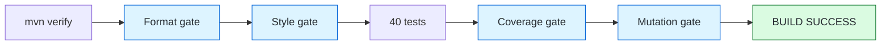

# Tidewater Freight: Rationale

Why the code looks the way it does now. The problems are in [ANALYSIS.md](ANALYSIS.md);
rules are cited from the AmaliTech Coding Standards, Java Edition (for example §6.1).

## 1. Decisions

### 1.1 Pin behaviour before changing it

- **Characterisation tests came first** (`ShippingCalculatorCharacterisationTest`). Ten exact prices, written against the starter code.
- **Every refactor ran against them.** A price that moved was a bug, not a style change.

### 1.2 Each zone is one `ZoneTariff`, and tariffs are data

- **Rate and fee live together** in `FlatRateTariff`, instead of split across a rate map and an `if/else` chain (ANALYSIS 3.3).
- **The rates live in a file,** `src/main/resources/tariffs.properties`, one line per zone. `PropertiesTariffLoader` reads it; `InMemoryTariffRepository` receives the result.
- **The calculator never names a zone.** It asks `TariffRepository` for a tariff and calls `costFor(weight)`. This is the open-closed principle (§12.2).
- **Trade-off:** the heavy surcharge stays a rule inside the calculator. One rule does not justify an interface; a second surcharge rule would become a `SurchargePolicy`.

### 1.3 The calculator receives its tariffs

- **Constructor injection** of `TariffRepository`, checked with `Objects.requireNonNull` (§12.5).
- **Tests can hand it a fake.** `ShippingCalculatorTest` mocks the repository and the tariff, so a pass proves the calculator's own rules.

### 1.4 Failures throw, never price at 0

- **The catch-all is gone** (ANALYSIS 3.1, Critical).
- **One base, one exception per failure.** `ShippingException` is the abstract base; `UnknownZoneException`, `InvalidShipmentException` and `TariffConfigurationException` say what went wrong.
- **Catch only where it adds something.** The pricing path has no catch: nothing there can recover, so a catch could only hide the failure (§6.1).
- **The loader's catch adds context.** A bad number or an unreadable file becomes a `TariffConfigurationException` naming the zone and the file, with the original as the cause (§6.3).
- **The last catch sits at the boundary.** `Demo` catches `ShippingException` and says why the shipment could not be priced. A real caller (an API, a UI) would do the same.

### 1.5 Bad input is rejected once, on construction

- **`Shipment` is a record** that refuses a blank zone, a null service level, and a missing, zero or negative weight.
- **It replaces three loose parameters** (§4.3), so the calculator never sees invalid data.

### 1.6 Money and weight are `BigDecimal`

- **No floating-point anywhere in the price.** Weight, rates, fees, surcharge and threshold are all `BigDecimal`. REGIONAL 2.3 kg EXPRESS is `42.60`, not `42.599999999999994`.
- **Rounded once, at the end:** two places, `HALF_UP`.

### 1.7 Zones stay strings

- **Zones are data, not code.** An enum would need a code change and a release for every new zone; a string comes from the tariff file.
- **They still fail loudly.** An unknown zone throws `UnknownZoneException`; it can no longer become GHS 0.
- **Trade-off:** no compile-time check on zone names. Acceptable, because the tariff file is the one place that defines them.

### 1.8 Layout follows the standard

- **Packages by feature** (§11.1): `shipment`, `tariff`, `pricing`, `demo`. Each exception sits in the feature that throws it; only the shared base is at the root.
- **Imports in two blocks**, static then the rest in ASCII order (§11.1). The Red Hat extension's default (six groups) was checked and not used, because it breaks this rule.

## 2. Adding the new zone

No Java class changes for a zone that prices like the others. That was the point of 1.2.

| New zone prices like... | Change |
|---|---|
| The others (rate per kg plus a fee) | One line in `tariffs.properties`: `COASTAL=12,15` |
| Something new (tiers, minimum charge) | A new class that `implements ZoneTariff`, added to the map the repository is built from |

Then add one characterisation test with the agreed price. A typo in the file (a missing
fee, a negative rate, a word instead of a number) stops the service at start-up with a
message naming the zone.

## 3. Kept, fixed, rewritten

| | What | Why |
|---|---|---|
| **Kept** | Every price rule and number: rates, fees, the 20 surcharge over 30 kg, express ×1.5 applied last | Behaviour belongs to the business, not to the refactor |
| **Kept** | The repository interface idea | Right seam, just bypassed with `new` (ANALYSIS 3.4) |
| **Fixed** | Catch-all, missing validation, `double` money and weight, `println` in the calculator, magic numbers, generic exception, vague names | ANALYSIS 3.1, 3.5, 3.7, 3.8, 3.10, 3.11, 3.14 |
| **Rewritten** | `calculateCost` (six jobs down to lookup, surcharge, service level) | ANALYSIS 3.2 |
| **Rewritten** | The zone `if/else` chain and hard-coded rates, now one line per zone in `tariffs.properties` | ANALYSIS 3.3 |
| **Rewritten** | All three tests | None of them could fail (ANALYSIS 4) |

## 4. Business rules kept and pinned

Current behaviour is kept and pinned by a test, so changing it is a deliberate act.

| Rule (ANALYSIS 3.9) | Behaviour | Pinned by |
|---|---|---|
| Does express ×1.5 also multiply fees and the surcharge? | Yes: INTERNATIONAL 40 kg EXPRESS = 967.50 | `appliesExpressAfterFeesAndSurcharge`, `appliesExpressToTariffPlusSurcharge` |
| Does exactly 30 kg get the surcharge? | No: 150.00; 30.1 kg gives 170.50 | `noHeavySurchargeAtExactlyThirtyKg`, `addsNoSurchargeAtExactlyThirtyKg`, `addsHeavySurchargeJustOverThirtyKg` |

## 5. Tests

| | Before | After |
|---|---|---|
| Tests | 3 (none could fail) | 40 |
| Mutants killed (PIT) | 3 of 18 | 18 of 18 |
| Line coverage | 61% | 100% lines and branches |

| Test class | What it proves |
|---|---|
| `ShippingCalculatorCharacterisationTest` | Ten exact prices with the real tariff file, including both 30 kg boundaries and rounding |
| `ShippingCalculatorTest` | The calculator's own rules with a mocked repository and tariff: surcharge, the 30 kg boundary, express order, rounding, unknown zone, missing repository |
| `ShipmentTest` | Every invalid input is rejected; a valid one is kept as given |
| `InMemoryTariffRepositoryTest` | A known zone returns its tariff; an unknown zone throws with the zone name |
| `PropertiesTariffLoaderTest` | Each zone in the file loads with the right rate and fee; a missing file, an empty file, a wrong field count, a word, a negative amount and an unreadable stream each fail with context |

- **Every assertion checks a value.** No `> 0`, no `assertNotNull` on a primitive, no mock of the class under test.
- **The mocks use a zone that does not exist yet** (`COASTAL`), so the calculator is shown to work for the new zone unchanged.
- **`Demo` is excluded** from coverage and PIT: it prints examples and holds no logic.
- **PIT skips records**, so it says nothing about `Shipment`. `ShipmentTest` guards that validation.

## 6. Improvement beyond the brief: the standard enforces itself

The brief fixes this code once. The next AI-written change could undo it. So the
standard is now checked by tools, in the editor and in the build.

| Gate | Tool | Fails the build when |
|---|---|---|
| Format | formatter-maven-plugin | any file differs from the shared formatter profile |
| Style | Checkstyle, [config/checkstyle.xml](config/checkstyle.xml) | a rule from §3, §4, §6, §7 or §11 is broken (each rule names its section) |
| Coverage | JaCoCo | line or branch coverage drops below 100% (§9) |
| Mutation | PIT | fewer than 90% of mutants are killed, so hollow tests fail the build |

- **One formatter profile for every project.** It lives in its own repo, [vscode-java-formatter](https://github.com/athanasius-amalitech/vscode-java-formatter). VS Code applies it on save; the format gate applies the same file in the build, so the editor and CI cannot disagree.
- **Pinned for a reproducible build.** The build reads the profile at one fixed commit; moving the pin is a deliberate change in `pom.xml`.
- **Proven, not assumed.** Each gate was broken on purpose once (a wildcard import and a catch-all, a 2-space indent, running only `ShipmentTest`, deleting an assertion) and failed the build.
- **Trade-off:** the format gate downloads the profile, so the first build needs network access. Run `mvn formatter:format` to fix a formatting failure.
- **Trade-off:** JaCoCo adds each run to the last. Use `mvn clean verify` for a trustworthy number.

## 7. Lessons from working with AI tools

- **A suggestion is code to review.** Copilot named `ServiceLevel.applyTo` as `getPriceMultiplier(double cost)`, a getter name for a method that calculates. It was renamed and the assistant switched off for this lab.
- **Passing tests can be luck.** A refactor dropped the rounding, and every test still passed because their prices happened to have two decimals. A 3.33 kg case (`54.960`) exposed it; the fix came with a test that failed first (`roundsPriceWithThreeDecimalsToTwo`).
